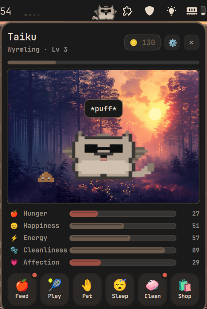
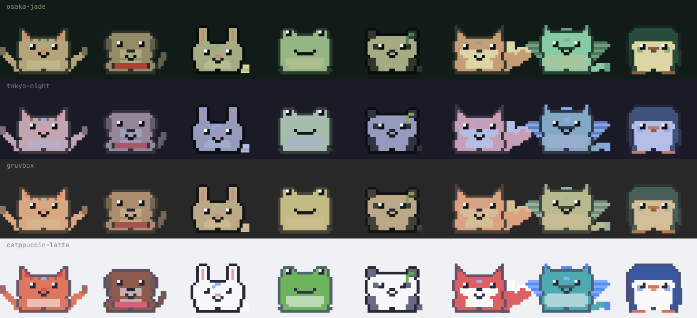

# Omarchy Pet

A tiny pixel-art Tamagotchi that lives on your [Omarchy](https://omarchy.org/) bar.
It wanders along the bar, naps, hops and looks around on its own, and only comes
to rest in the gaps between your bar widgets. Click it to open
a care card: feed it, play, stroke it, put it to bed, clean up after it, and watch
it grow. Everything is painted in your current Omarchy theme and repaints when you
switch themes.

<div align="center">
    
</div>

The pets are painted from your theme, not from a fixed palette. On a dark theme each
one wears your widgets' text colour, tinted with its own hue and a single accent; on
a light theme it is a soft version of that hue. They sit quietly in the bar and follow
every theme switch.

<div align="center">
    
</div>

## Install

```sh
omarchy plugin add https://github.com/taiku666/omarchy-pet.git --enable
```

The first time, the care card opens so you can pick a pet and name it. Tap the egg
five times to hatch it.

Update with `omarchy plugin update io.github.taiku666.omarchy-pet && omarchy restart shell`.
Remove with `omarchy plugin remove io.github.taiku666.omarchy-pet`.

Sound uses `pw-play` (PipeWire), which Omarchy ships.

## The pets

| Pet | Personality |
|---|---|
| 🐱 Cat | Aloof, then clingy. Purrs when stroked, flicks its tail, kneads. Loves fish. |
| 🐶 Dog | Loyal and loud. Barks, runs, wags. Needs lots of attention. Loves bones. |
| 🐰 Bunny | Shy hopper. Nibbles, twitches, does a binky. Loves carrots. |
| 🐸 Frog | Chill and swampy. Snaps at flies, croaks. Gets dirty fast. |
| 🐼 Panda | Lazy foodie. Munches bamboo, rolls over. Always hungry. |
| 🦊 Fox | Clever and playful. Pounces, zooms, tilts its head. |
| 🐉 Baby Dragon | Tiny and fiery. Puffs fire, flaps its wings. Loves peppers. |
| 🐧 Penguin | Social waddler. Slides on its belly. Stays clean. |

Each pet has its own look, idle behaviours, stroke reaction, voice, favourite food,
and four growth stages (the adult form wears something extra).

## Using it

| Action | Result |
|---|---|
| Click the pet on the bar | Open / close the care card |
| Drag across the pet | Stroke it: hearts, affection, a pet-specific happy face |
| Feed | Pick a food from your pantry; favourites make it extra happy. Apples are free and never run out, everything else is used up |
| Play | 15 second mini-games: catch the ball, pop bubbles, chase the laser dot, jump rope, tug the yarn, peekaboo |
| Pet | Stroke mode: strokes count double |
| Sleep / Wake | A nap restores energy; sleeping pets can't be fed or played with |
| Clean | Wash the home, or click a single mess to remove it |
| Shop | Spend coins on hats and toys, and buy food by the portion |
| ⚙ | Sound, volume, rename, goals, reset |

While the card is open the pet stays inside it, in front of your desktop wallpaper.
Close the card and it walks back onto the bar.

On the bar the pet may walk over other widgets, but it only stops, naps or hops
where there is free space. If the bar has no gap wide enough, it settles in the
middle.

### Needs

Hunger, happiness, energy, cleanliness and affection change gradually. A neglected
pet gets hungry, tired or sad, shown by its face and a small thought bubble, but
needs never fall to zero and a happy pet is always one cuddle away. Time you spend
away counts at a gentler rate, so coming back after a weekend is a hello rather than
a rescue.

### Progression

- XP for feeding, playing and cleaning, levels, and four growth stages per pet
- Coins from mini-games, a daily care streak and found coins
- Hats and toys to unlock, food to restock, plus goals with coin rewards
- State is saved in `~/.local/share/omarchy-pet/state.json`

## Keybinding

Toggle the care card from Hyprland:

```lua
-- ~/.config/hypr/bindings.lua
o.bind("SUPER + ALT + P", "Pet", "omarchy-shell pet toggle")
```

The IPC target is `pet`, with `toggle`, `show` and `hide` (`hide` removes the pet
from the bar until you `show` it again).

## Notes

- Works with a horizontal bar (top or bottom). With a vertical bar the pet is not
  drawn on it.
- The card's backdrop is your current wallpaper (`~/.local/state/omarchy/current/background`).
  With a video wallpaper, or none, it falls back to a plain surface.
- The pet finds free spots by polling the shell's bar geometry
  (`omarchy-shell shell debugBarGeometry`) every 1.5 seconds while it is on the bar.
- Colours come from the active theme's `colors.toml` and the shell's popup colours,
  so there is nothing to configure.

## Security

- **No network.** The plugin makes no HTTP requests and fetches nothing remote.
- **No installs.** It never installs, upgrades or removes packages, and never uses `sudo`.
- **Fixed commands only.** Every process is started from an argument list, never a shell string:
  `mkdir -p` (its data folder), `pw-play` (bundled sounds), `pgrep` (screensaver check),
  `readlink -f` (current wallpaper) and `omarchy-shell shell debugBarGeometry` (bar layout).
- **Local files only.** It writes `~/.local/share/omarchy-pet/state.json` (atomic writes) and reads
  that file, the theme's `colors.toml` and the current wallpaper. The wallpaper is decoded at a capped size.
- **Untrusted saves.** `state.json` is parsed defensively: prototype-polluting keys are ignored and
  values such as stats, level, coins and volume are clamped. Covered by `test/logic.test.mjs`.

## Development

```sh
node --test test/                 # rules, sprites, animation tables
python3 tools/make-sfx.py         # regenerate assets/sfx
node tools/preview.mjs out.svg    # contact sheet of the sprites
node tools/gallery.mjs g.svg      # every pet in a few themes (README gallery)
```

`Logic.js` holds the rules and is pure, `Sprites.js` the pixel art, `Anim.js` the
behaviours, `Palette.js` turns a theme into pet colours, `Theme.qml` the rest of the colours.

## License

MIT
